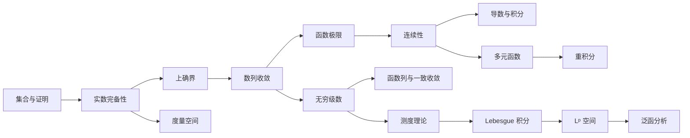

<div align="center">

# ✦ Math Atlas · 数学分析知识宇宙

**一个以“知识关联 + 严格证明 + AI 引导”为核心的开放式数学分析资源库。**  
*An open, graph-driven learning space for mathematical analysis.*


[](#课程范围) [](#知识图谱) [](#功能一览) [](LICENSE)

**探索星图 · 循序学习 · 主动证明 · 与 AI 对话**

</div>

> [!IMPORTANT]
> **可直接运行的是完整的静态学习站点。** AI 导师默认使用清楚标注的本地预设引导，不是在线大模型。连接真正的生成式 AI，需要自行部署安全 API 代理、设置模型密钥及防滥用措施；仓库中不存储任何密钥。60 个知识节点覆盖五个学习层级，其中 15 个重点节点包含逐步推导，其余为结构化概念导读，不宣称已经包含整套学术级教材。

## ✨ 这不只是“资料链接合集”

| 模块 | 目前可用的内容 |
| --- | --- |
| **✧ 知识星图** | 60 个节点、104 条有向先修关系；支持筛选、拖动、缩放、关联高亮、节点详情与路径跳转。|
| **⌁ 五阶学习路径** | 预备桥梁 → 数学分析 I → 数学分析 II → 多元分析 III → 高阶分析；根据先修概念掌握情况推荐下一站。|
| **▤ 知识卡片** | 每个节点包含定义概览、公式、直觉、常见误区及反思问题；15 张重点讲义含证明步骤、例题、延伸问题。|
| **◇ 分层题库** | 46 道原创练习，覆盖预备/入门/进阶/拔高/高阶；选择/数值题即时判定、证明题以评分要点自评。|
| **ε 极限实验室** | ε–δ 函数极限与 ε–N 数列极限：实时图像、滑杆、解析检验与严格证明提示。|
| **✦ AI 引导导师** | 本地苏格拉底式引导和可选真实 AI 代理；支持知识点上下文、证明模式、例题模式，避免直接输出无条件“正确”的反馈。|
| **◎ 学习档案** | 浏览、收藏、已掌握、练习记录、连续学习天数保存在当前浏览器 `localStorage` 中。|
| **▧ 开放资源馆** | MIT OCW、OpenStax、3Blue1Brown、KaTeX 等原站资源的入口。|

## 🚀 30 秒本地启动

```bash
# 进入项目根目录（Node 用于验证数据；运行网站本身不需要 npm 安装）
python3 -m http.server 8000
# 浏览器打开 http://localhost:8000
```

也可以运行：

```bash
npm run validate    # 验证知识依赖的完整性、无环性和习题数据
npm run serve       # Python 静态文件服务（端口 8000）
```

**不要直接双击 `index.html` 用 `file://` 打开。** 页面通过 `fetch` 加载数据，需要 HTTP 服务。发布到 GitHub Pages 后可正常加载。

## 课程范围

| Level | 路线 | 内容示例 | 学习深度 |
| :---: | --- | --- | --- |
| 00 | 预备桥梁 | 集合与逻辑、函数、不等式、归纳法、反证法 | 数学语言与证明习惯 |
| 01 | 数学分析 I | 实数完备性、上确界、ε–N、ε–δ、微分、Riemann 积分 | 微积分的严格基础 |
| 02 | 数学分析 II | 级数、逐点与一致收敛、幂级数、反常积分 | 无穷过程与换序条件 |
| 03 | 多元分析 III | 多元微分、隐函数、Hessian、重积分、Jacobi、Green/Stokes/Gauss | 多维空间分析 |
| 04 | 高阶分析 | 度量与紧致性、测度、Lebesgue 积分、Lᵖ、Banach/Hilbert、弱导数 | 高阶课程衔接 |

### 知识图谱

图谱边的方向是 **先修概念 → 目标概念**。下面仅展示其中一条主线：



**图谱是内容结构，不是装饰性的关系图**。打开任意节点，可以沿其前置概念回溯，或沿后续概念延伸。图数据位于 `data/curriculum.json`，每条边均可审查。

## 🔐 AI 接入的边界

静态页面无法安全地保存模型 API Key，因此分为两种运行方式：

**模式 A · 本地教学引导（开箱即用）**  
由经过编写的教学脚本提供定义回顾、前置概念、误区提醒和思考问题。**不分析自由输入的数学正确性，不宣称自动批改证明。**

**模式 B · 真实 AI 对话（选配）**  
将 `backend/worker.js` 作为 Cloudflare Worker 部署，并在 Worker Secret 中设置模型 Key；前端只保存 HTTPS API 地址。服务端使用主题与练习上下文，给出逐层提示、提问和证明审查。**上线前必须添加身份校验 / Turnstile、请求频率限制、费用预算与监控。** 示例 Worker 未内置完整的生产级防滥用保护。

详细配置：[部署指南](docs/DEPLOYMENT.md) · [教学设计原则](docs/PEDAGOGY.md)

## 📂 项目结构

```text
math-analysis-atlas/
├── index.html                 # 单页式学习网站入口
├── assets/
│   ├── app.js                 # 交互、路由、图谱、题库、实验及 AI 辅导
│   ├── style.css              # 自适应界面设计
│   ├── favicon.svg            # 项目标识
│   └── preview.png            # 网页预览
├── data/
│   ├── curriculum.json        # 60 个知识点 + 104 条先修关系
│   ├── exercises.json         # 46 道分层原创练习
│   └── lessons.json           # 15 个重点知识的详细推导
├── backend/
│   ├── worker.js              # 可选的服务端 AI 代理示例
│   └── wrangler.toml.example  # Cloudflare Worker 配置模板
├── scripts/validate.mjs      # DAG、数据结构与答案格式检查
├── docs/                      # 架构、教学设计、部署、研究、共建规范
├── .github/workflows/
│   ├── validate.yml           # 提交校验
│   └── pages.yml              # GitHub Pages 自动部署
└── LICENSE                    # 源代码 MIT 许可
```

## 📚 内容与许可

- 本项目原创撰写的知识概览、习题与讲义随代码以 **MIT License** 提供，不包括外部链接的教材与视频本体。
- 外部网站、课程、教材保留其各自版权及使用许可。尤其是 OpenStax 和 MIT OCW，需根据原站所标注的 Creative Commons 条件判断能否转载、修改或用于商业用途。
- 我们采取 **链接到原站** 的方式，而非复制课程全文。请见 [研究与参考资料](docs/RESEARCH.md)。
- 内容当前是开放式教育项目的首版，不替代完整课程、人工批改或正式考试评价。

## 🤝 参与共建

欢迎提交数学错误修正、证明严谨性改进、对抗性反例、更好的先修关系、分层练习与交互实验。具体规范见 [CONTRIBUTING.md](docs/CONTRIBUTING.md)。

**Roadmap:** [docs/ROADMAP.md](docs/ROADMAP.md) · **Architecture:** [docs/ARCHITECTURE.md](docs/ARCHITECTURE.md)

---

<div align="center">用理解连接知识，用证明检验理解。<br><sub>Math Atlas · A project prepared for <strong>xmulyssmathsoc</strong></sub></div>
