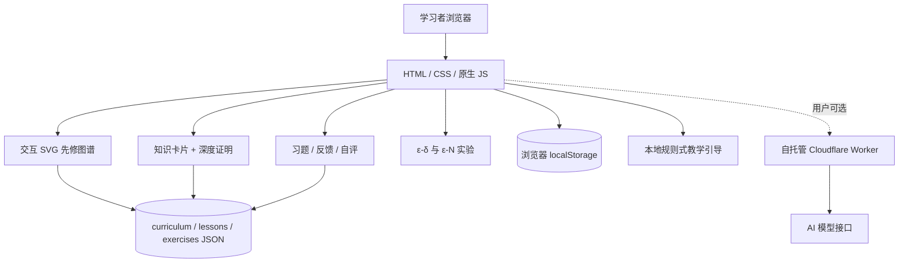

# Math Atlas · 系统架构

## 产品目标

Math Atlas 将知识内容组织成**可审查的先修有向无环图（DAG）**，而不是按教科书目录平铺。图上的节点同时关联“概念卡片—证明步骤—练习—AI 提问上下文—学习进度”，构成可扩展的数学教学数据模型。

## 运行架构



**前端**采用无打包器、无运行时框架的 ES module + JSON。这样可以直接托管于 GitHub Pages，不需要数据库，不需要静态构建步骤。数学公式通过外部 KaTeX CDN（加载失败时保留源公式文本）渲染。图谱由原生 SVG 绘制，支持节点与连线高亮、平移和缩放。

## 数据模型

节点示例：

```json
{
  "id": "seq-limit",
  "title": "数列极限 ε–N",
  "stage": 1,
  "family": "limit",
  "prerequisites": ["archimedean"],
  "summary": "用严格定义描述数列无限接近极限的过程。",
  "formula": "a_n\\to L\\iff\\forall\\varepsilon>0...",
  "intuition": "ε 是你定的精度，N 是我给出的响应。",
  "pitfall": "N 不依赖 n，但允许依赖 ε。",
  "inquiry": "给定 ε，怎样为 aₙ=1/n 选取 N？"
}
```

`data/lessons.json` 通过同名 `id` 扩展重点节点，提供定义、定理、完整证明分步、例题与思考题。题目中 `kind` 为 `choice` / `numeric` / `proof`，`topic` 指向节点 id，`difficulty` 为 0–4。不同题型的评分语义不同：选择题按选项索引、数值题按误差容忍度、证明题由学习者对照 rubric 自评。**证明题不由字符串匹配判为正确。**

## 自适应机制（v1）

1. 学习者主动标记已掌握的节点，前端保存于 `localStorage`。
2. 推荐引擎按课程顺序寻找所有前置节点均标记掌握、但自己尚未掌握的节点。
3. 图谱、课程卡片、答题列表中的完成状态同步更新。
4. 错题会保留最新判定，答对后可更新状态；证明题记录的是“完成自评”，并非已被机器证明为正确。

该机制是**基于先修关系的启发式推荐**，不是已校准的测量模型，也不是 IRT/BKT 的能力估计。不能用于选拔、评分或正式测验判断。

## 数学实验的严格性

- `f(x)=x²`、`x→2` 的极限实验计算邻域边界的误差上确界 `4δ+δ²`；页面同时给出保守可证明选择 `δ≤min(1,ε/5)`。图像采样不代替解析证明。
- `aₙ=1/n` 的实验对选定 `N` 精确检查最大尾项 `1/(N+1)` 是否严格小于 `ε`，并给出最小可行的非负整数 `N=floor(1/ε)`。

## 技术与安全边界

- 所有正文内容来自本仓库 JSON；用户输入被 HTML 转义后才进入界面。
- 学习记录只存在浏览器本地，不与外部站点共享；清理浏览器数据会丢失进度。
- 若启用 AI，用户输入与当前知识点将发送到自行配置的 API 代理，代理再发送给模型服务。请上线前设置隐私说明与用户同意机制。
- 示例 Worker 只提供 Origin 限制和服务端 Key 管理，**Origin/CORS 不是完整鉴权**，必须在对公网提供 API 前额外加上认证、速率限制、成本上限与监控。
- 前端的动态内容不是富文本编辑器；不执行不受信任的 HTML/JavaScript。

## 扩展建议

优先补充题目与证明数据的人工复核、引用出处和反例，然后增加知识点的“误区标签”、“认知需求级别”和“同义概念”。当节点规模扩大时，可引入 d3-force 或图数据库，但首版不需要增加不必要的基础设施。
